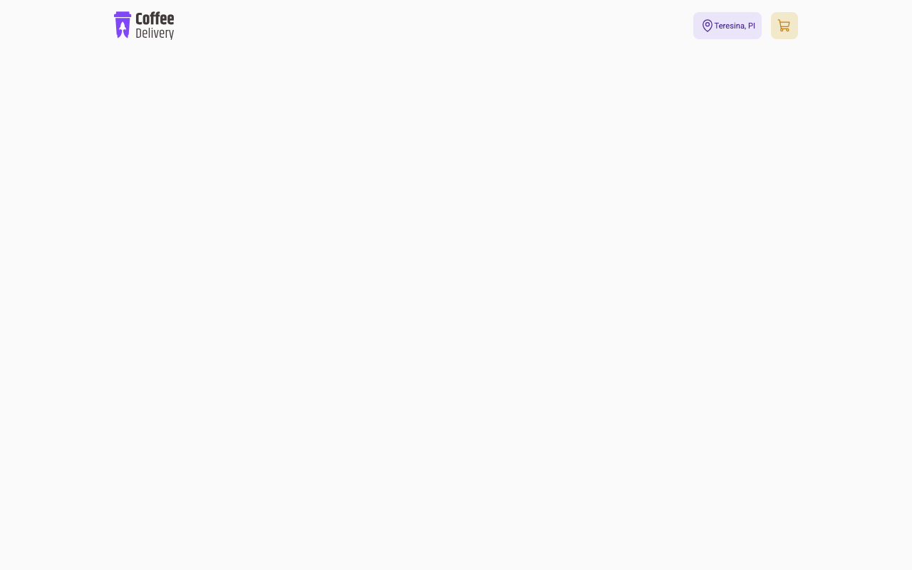

# ☕ Coffee Delivery

Interface de um e-commerce de cafés, desenvolvida como desafio do módulo de React da trilha **Ignite (Rocketseat)**. O projeto está em andamento: a estrutura base, o tema e o cabeçalho (logo, localização e carrinho) já estão implementados.



## Tecnologias

- [React 18](https://react.dev/) + [TypeScript](https://www.typescriptlang.org/)
- [Vite](https://vitejs.dev/)
- [styled-components](https://styled-components.com/) (tema e estilos globais)
- [Phosphor Icons](https://phosphoricons.com/)

## Como rodar

```bash
pnpm install   # ou npm install / yarn
pnpm dev       # http://localhost:5173
```

Outros scripts: `pnpm build` (build de produção) e `pnpm preview` (serve o build).

## Estrutura

```
src/
├── components/Nav/   # cabeçalho com logo, cidade e carrinho
├── styles/           # estilos globais e tema padrão
└── App.tsx
```

## Status

🚧 Em desenvolvimento — próximos passos: listagem de cafés, carrinho e checkout.

## Autor

Feito por [Amós Magalhães](https://github.com/amslimaa).
